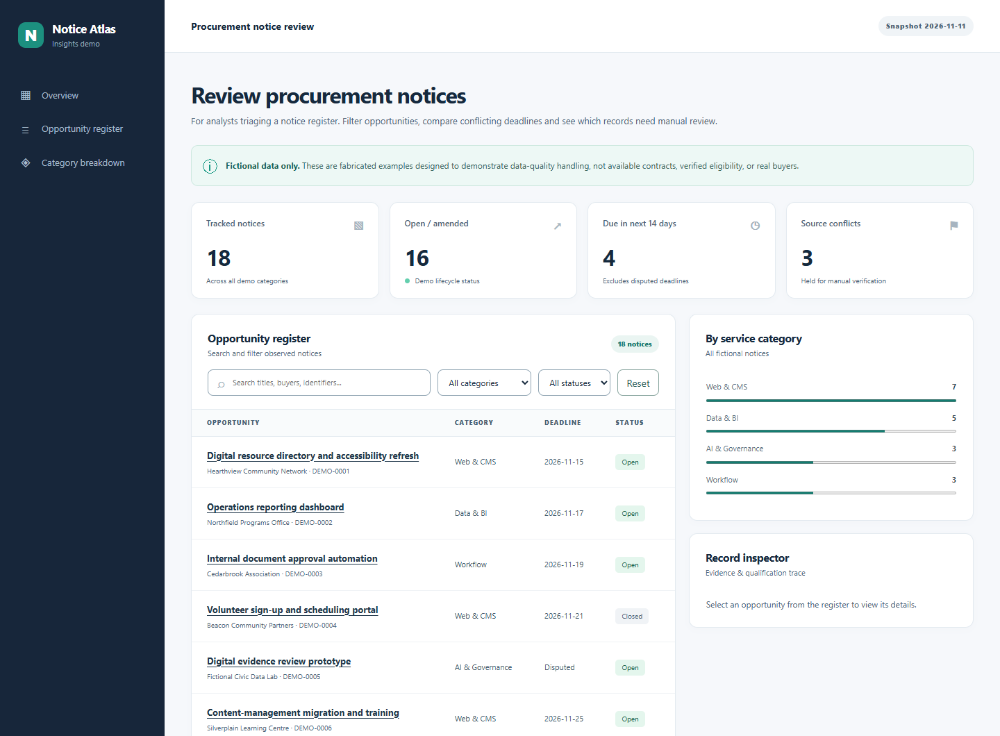

# Notice Atlas

**Independent data and software demo using 18 fictional procurement notices.** An analyst can narrow a notice register, review the evidence behind a disputed deadline, and keep that record out of time-sensitive reporting until a person verifies it.

- **Find a record.** Search by title, buyer, ID or summary, combine category and status filters, and reset the register in one action.
- **Compare two reported dates.** Search `DEMO-0005` and open the record to see each reported deadline, observation date and source label. The register shows **Disputed** while the sources disagree.
- **Check the dashboard totals.** The fixed snapshot shows 18 notices, three source conflicts and four open or amended notices due within 14 days. The due count excludes disputed deadlines.

[Deadline evidence](docs/deadline-evidence.png) · [Mobile inspector](docs/mobile-evidence.png)

The screenshots are from Edge Chromium at 1440px and 390px viewport widths, connected to the running Python API at `127.0.0.1:8768`. The API served the checked-in fictional fixture regenerated by `seed.py`.

## Run in three steps

1. With Python 3.10 or later, run `python seed.py` to regenerate the deterministic data.
2. Run `python -m unittest discover -s tests -v`.
3. Run `python server.py --port 8768` and open <http://127.0.0.1:8768>. Stop with Ctrl+C.

### Two-minute walkthrough

1. Search for `DEMO-0005`, set category to **AI & Governance** and status to **Open**. Confirm the result has a disputed deadline.
2. Tab to the record title and press Enter. Inspect the two source observations and the conflict event. Use **Back to selected notice** to return to the row.
3. Search for a nonexistent ID, then reset. Check that the previous detail clears, all records return, and the dataset-level category counts stay constant.

## Implementation and checks

`seed.py` produces the versioned JSON fixture. `server.py` exposes read-only summary, list and detail endpoints, and serves an explicit static file allowlist. `static/` contains a dependency-free interface. The browser filters the small bundled register locally after fetching it. The JSON API independently supports query, category, status and region parameters. The category chart describes the entire snapshot.

Disputed notices carry a null reporting deadline and two structured source observations. The server calculates the 14-day metric from the snapshot date with an inclusive upper bound. A source value can still be wrong when there is no recorded conflict. The UI uses native buttons, labelled controls, a live result count and a keyboard focus path into and out of the inspector.

Verified on Windows with Python 3.13 and Edge Chromium. All 9 Python tests passed, including live loopback HTTP checks for the detail payload, security headers and route allowlist. `node --check static/app.js` passed. Browser checks covered real API loading, search/category/status combinations, reset, keyboard focus, chart, conflicting evidence, empty results, responsive layout at 390px, and a deliberately interrupted request followed by a successful retry. No screen-reader or cross-browser audit was performed.

## Scope and license

This is self-directed research with fictional organizations, deadlines and indicative budgets. It uses no client materials, real tenders, awards, ingestion, verified eligibility or commercial results. The standard-library HTTP server is a localhost demonstration with no authentication, persistence or operational monitoring. Run it locally.

Original example source is MIT licensed. The project uses system fonts and contains no bundled external assets. Public distribution requires owner approval of the extracted standalone copy.
